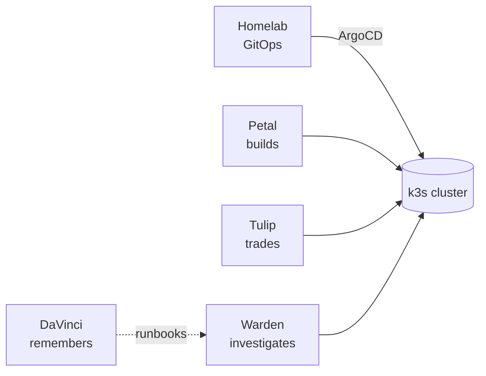

# Hallo! I'm Steve 👋

Software Engineering (Co-op) student at McGill with a minor in Applied AI. I like computer
networking, robotics and 3D modelling, and I'm Software Lead for the McGill Robotics Rover Team.

Most of my time right now goes into a **self-hosted platform I run at home**: a GitOps k3s
cluster plus a handful of Go services that build, trade, investigate and remember things on it.

## 🏠 The homelab

| Repo | What it is | Stack |
|---|---|---|
| [**Homelab**](https://github.com/Blacklotus89898/Homelab) | The umbrella repo. Everything that runs is declared here: ArgoCD app-of-apps, Istio ambient + Gateway API front door, VictoriaMetrics/Grafana, sealed secrets, Backstage, 11 ADRs and a bare-metal rebuild guide | k3s, ArgoCD, Istio, Helm, Kustomize |
| [**Petal**](https://github.com/Blacklotus89898/Petal) 🌸 | Pipeline orchestrator. Schedules, deduplicates and records repo-native YAML pipelines that run as plain Docker containers | Go, SQLite, React |
| [**Tulip**](https://github.com/Blacklotus89898/Tulip) 🌷 | Human-approved trading agent (paper). Rules and Claude propose, a deterministic risk gate disposes, nothing trades without a thumbs-up, and shadow books score every strategy | Go, SQLite, MCP |
| [**Warden**](https://github.com/Blacklotus89898/Warden) | Read-only incident investigator. Collects evidence for every alert and draws a live status map of the cluster | Go, Kubernetes API |
| [**DaVinci**](https://github.com/Blacklotus89898/DaVinci) | Markdown knowledge base with hybrid search, exposed as an MCP server. Runbooks and postmortems the agents read before acting | Go, SQLite FTS5, Ollama |

## 🤖 Robotics and other projects

- [InHouseROS](https://github.com/Blacklotus89898/InHouseROS): my own take on the Robot Operating System, in C++
- [MyROS2](https://github.com/Blacklotus89898/MyROS2) / [MyROS](https://github.com/Blacklotus89898/MyROS): ROS 2 and ROS Noetic robotics (Python, OpenCV, WebRTC)
- [Sodalite](https://github.com/Blacklotus89898/Sodalite): collaborative student dashboard (React, TypeScript, WebRTC)
- [Immovable](https://github.com/Blacklotus89898/Immovable) (Rust, WebAssembly), [GoForSpeed](https://github.com/Blacklotus89898/GoForSpeed) (Go, gRPC)
- [Portfolio](https://blacklotus89898.github.io/Portfolio/)

## 💻 Tech

             

## 📫 Contact

[Website](https://cs.mcgill.ca/~schen183/) · [steve.chen@mail.mcgill.ca](mailto:steve.chen@mail.mcgill.ca)

